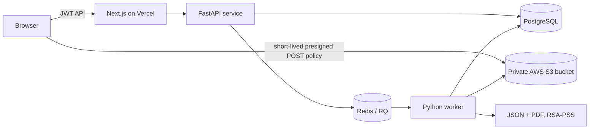

# SecureWipe

SecureWipe contains a legacy Windows desktop utility and a new cloud workflow for small text files. The web service accepts `.txt`, `.csv`, and `.json` files up to 25 MiB, classifies a bounded sample, queues a deletion job, checks object absence, and issues a signed JSON/PDF record.

**The cloud workflow is not physical-media sanitization.** An S3 `DeleteObject` request and a subsequent missing-object response do not establish that provider replicas, snapshots, backups, caches, or underlying flash cells were erased. It does not wipe a user's local disk. The current UI and certificate state this limitation; do not use it as a compliance attestation for physical media destruction.

## Architecture



The browser never receives storage credentials or the OpenAI key. `backend/app` owns the API, auth, persistence and services. `worker/Dockerfile` runs the asynchronous RQ consumer. `cleanup` removes expired incomplete/failed uploads on a minute loop. `web/` is independently deployable with Vercel Root Directory `web`. The original `main.py` and `src/` desktop client remain independent and are not imported by the cloud path.

## Workflow and implementation limits

1. Register/sign in; a 12-hour bearer token is held in browser session storage.
2. The API issues a five-minute presigned POST policy for a unique key. S3 enforces the upload byte range; bucket access must remain private and server-side encryption must be enabled.
3. Completion checks stored size and MIME metadata. Job creation reads UTF-8 text, applies regex checks, and optionally sends up to 12 KiB to OpenAI when `OPENAI_API_KEY` is set.
4. RQ worker hashes the input, deletes the object, checks that `HEAD` no longer finds it, signs metadata, and stores certificate JSON/PDF and audit events in PostgreSQL.
5. Account owners can list jobs/certificates and download JSON/PDF. `/verify/{certificate_id}` is public and returns signed certificate data after cryptographic verification.

Classification is heuristic and can miss data. The OpenAI result is advisory. The supported document types are currently text, CSV and JSON only; content is held in worker/API memory during processing. Maximum upload size defaults to 25 MiB. The retention selector controls cleanup for failed or abandoned uploads (1, 6 or 24 hours); successful job input objects are deleted during processing. Provider versioning, backups, object lock and lifecycle settings must be configured and evaluated separately.

## Technology

- Next.js 15, React, TypeScript, Tailwind CSS 4
- FastAPI, Pydantic settings, SQLAlchemy, PostgreSQL
- Redis and RQ; separately deployed Python worker
- Private Amazon S3 object storage (POST policy upload path)
- Optional OpenAI Responses API classification
- RSA-PSS SHA-256 signatures, ReportLab PDF output
- Docker Compose for local service orchestration; GitHub Actions for builds, tests, lint and image checks

## Local development

Prerequisites: Docker Compose v2, Node.js 22/npm, Python 3.12 (for tests or direct backend use). First copy `.env.example` to `.env`, replace the placeholder passwords/secrets, and configure a reachable private AWS S3 bucket. Generate a signing key and base64-encode its PEM bytes for `CERTIFICATE_PRIVATE_KEY` in `.env`:

```powershell
Copy-Item .env.example .env
openssl genpkey -algorithm RSA -pkeyopt rsa_keygen_bits:3072 -out signing-private.pem
openssl pkey -in signing-private.pem -pubout -out signing-public.pem
$envPath = (Resolve-Path .env).Path
$envText = [IO.File]::ReadAllText($envPath)
$privateB64 = [Convert]::ToBase64String([IO.File]::ReadAllBytes((Resolve-Path signing-private.pem)))
$envText = $envText.Replace('CERTIFICATE_PRIVATE_KEY=""', "CERTIFICATE_PRIVATE_KEY=$privateB64")
[IO.File]::WriteAllText($envPath, $envText, [System.Text.UTF8Encoding]::new($false))
```

The command writes the encoded private key to the untracked `.env` file. `PUBLIC_VERIFICATION_KEY` is optional. Set a random `JWT_SECRET` of at least 32 characters, a strong `POSTGRES_PASSWORD`, S3 credentials restricted to the one private bucket, and `ALLOWED_ORIGINS` to the actual frontend origin. Avoid committing the key files.

```powershell
docker compose up --build
```

Visit `http://localhost:3000`; API health is at `http://localhost:8000/health`. The API creates initial tables at startup. Schema upgrades currently require an explicit database migration plan; do not rely on `create_all` as a production migration system.

For web-only work:

```powershell
cd web
Copy-Item .env.example .env.local
npm ci
npm run dev
```

For backend tests:

```powershell
python -m pip install -r backend/requirements.txt
python -m pip install pytest
python -m pytest tests
```

## Environment variables

| Variable | Used by | Purpose |
|---|---|---|
| `DATABASE_URL` | API, worker, cleanup | PostgreSQL connection |
| `POSTGRES_PASSWORD` | Compose | Local database password |
| `REDIS_URL` | API, worker | RQ queue and rate-limit storage |
| `OPENAI_API_KEY` | API | Optional classification; never expose publicly |
| `STORAGE_ENDPOINT`, `STORAGE_REGION`, `STORAGE_BUCKET`, `STORAGE_ACCESS_KEY`, `STORAGE_SECRET_KEY` | API, worker, cleanup | Private AWS S3 configuration; endpoint may be blank for AWS |
| `CERTIFICATE_PRIVATE_KEY` | API, worker | Base64 PEM RSA private signing key; keep secret |
| `PUBLIC_VERIFICATION_KEY` | API configuration | Optional expected public key for matching check |
| `JWT_SECRET` | API | At least 32 random characters |
| `VERIFY_BASE_URL` | operator/config | Public site origin for deployment configuration |
| `UPLOAD_MAX_BYTES` | API | Upload cap; defaults to 25 MiB |
| `RETENTION_HOURS` | API | Default unfinished-upload retention |
| `ALLOWED_ORIGINS` | API | Comma-separated exact browser origins |
| `NEXT_PUBLIC_API_URL` | web build | Public FastAPI URL; Vercel variable |
| `NEXT_PUBLIC_APP_URL` | web build | Public frontend URL; Vercel variable |

No `NEXT_PUBLIC_*` value may contain credentials.

## Deployments

### Database, queue, storage and backend

Run PostgreSQL and Redis as managed services or private containers. Provision an encrypted, private AWS S3 bucket, block public access, restrict credentials to required object operations, and set provider lifecycle cleanup. Deploy `backend/Dockerfile` as an always-available container API and `worker/Dockerfile` as a separate long-running service with the same private env values. Deploy the worker image command `rq worker --url "$REDIS_URL" securewipe`; deploy a second copy of the worker image with command `python -m app.cleanup` for retention cleanup. Use Cloud Run/Cloud Run Jobs, ECS/Fargate, or Azure Container Apps. Configure health checks, HTTPS, private database/Redis networking, backups, and secret manager integrations.

The upload path uses an S3 presigned HTML form POST so the provider can enforce the file-size range before receiving bytes. AWS S3 supports POST policy size conditions. Cloudflare R2 currently documents presigned `GET`, `HEAD`, `PUT`, and `DELETE` but not form `POST`, so R2 needs a different bounded-upload design before it can be used here ([R2 support](https://developers.cloudflare.com/r2/api/s3/presigned-urls/), [AWS POST policy](https://docs.aws.amazon.com/AmazonS3/latest/developerguide/sigv4-HTTPPOSTConstructPolicy.html)).

The project does not contain cloud account resources, migrations, provider lifecycle policies, or configured production secrets. Creating those requires deployment-specific account access. `docker-compose.yml` is for local development; it is not a production topology.

### Vercel frontend

Import the repository into Vercel, set **Root Directory** to `web`, and set `NEXT_PUBLIC_API_URL` and `NEXT_PUBLIC_APP_URL` for the deployed origins. Configure the backend `ALLOWED_ORIGINS` with the exact Vercel origin. Deploy the API and persistent worker separately; neither belongs in a Vercel serverless function.

### GitHub Actions

The Windows release workflow remains for the desktop utility. Cloud CI runs the frontend production build, Python unit tests/lint and Docker image builds. It does not deploy infrastructure or publish images with secrets.

## Security and threat model

The design protects object keys from direct public access, scopes database reads/writes by account, uses presigned URLs with short expiry, limits size/type, uses TLS at deployment, hashes passwords with PBKDF2-HMAC-SHA256, signs certificates with RSA-PSS, rate limits API requests, and avoids recording file content in audit metadata. Do not log raw auth tokens, secrets or file contents.

This is not a complete production identity system: registration has no email verification, MFA, recovery flow or admin controls. Browser tokens are accessible to same-origin script; XSS prevention and a hardened CSP still need deployment review. Rate limiting is shared through Redis by IP, but proxy/network controls must preserve the correct client address. SQL schema migration, abuse monitoring, malware scanning, private bucket lifecycle configuration, key rotation/revocation, and backup policy require operator work. Public certificates reveal their signed metadata. No compliance certification is claimed.

The older `src/wipe_engine.py` performs local file overwrite/unlink attempts. Filesystem overwrite semantics vary, especially on SSD, copy-on-write and virtual storage; those routines must not be interpreted as a cloud sanitization method. `main.py` remains desktop-only and uses Tkinter; the cloud application does not require it.

## Verification status

Unit tests exercise advisory classification, password hashing and certificate signing/tamper detection. CI adds builds and static/security checks. An end-to-end cloud run requires working Postgres, Redis, object storage credentials, signing key, OpenAI key if AI is desired, and deployed frontend/API origins. Those external services and credentials are not bundled with the repository, so a real deployed workflow cannot be asserted from a source checkout alone.
